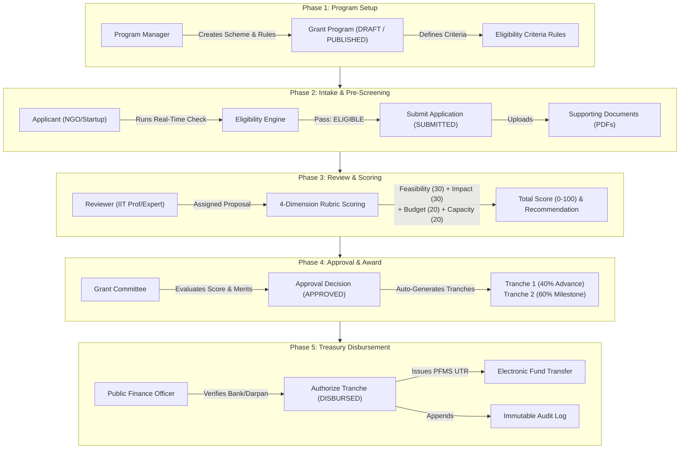
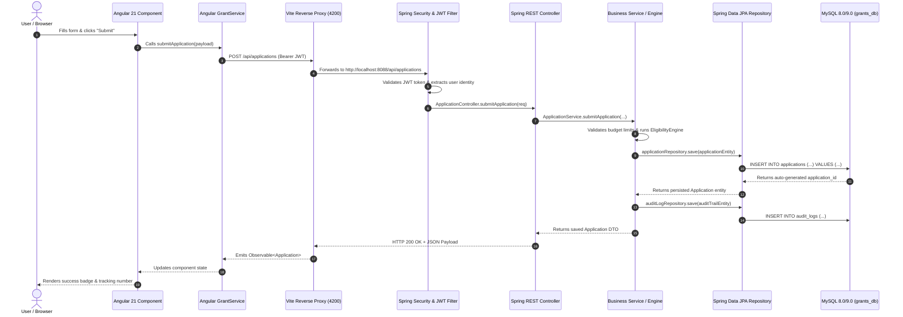
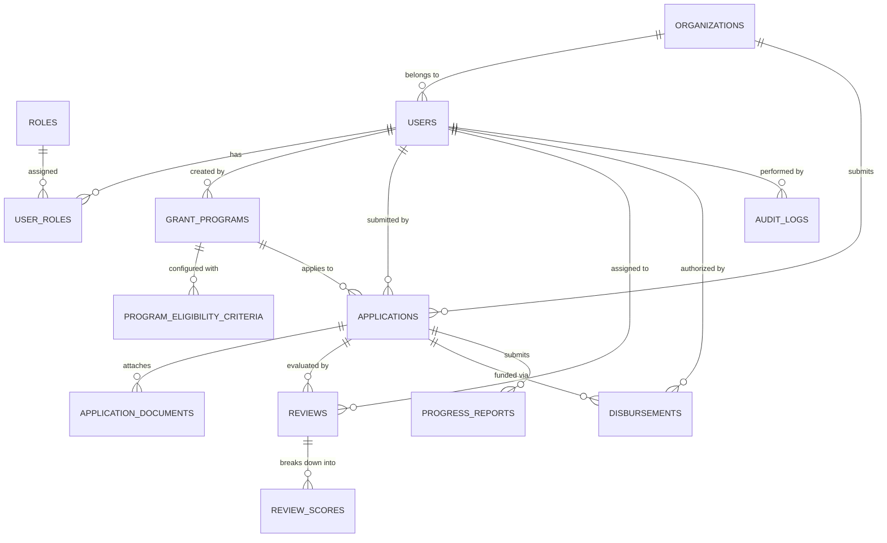

# GRANTS MANAGEMENT SYSTEM (Government & Public Sector)
## Comprehensive Faculty Presentation Guide & Technical Deep-Dive

---

### Table of Contents
1. [Project Overview & Elevator Pitch](#1-project-overview--elevator-pitch)
2. [End-to-End Data Workflow (The 5 Lifecycle Phases)](#2-end-to-end-data-workflow)
3. [Technical Data Flow (From Angular Click to MySQL Disk)](#3-technical-data-flow)
4. [Codebase Anatomy: What Part of Code Does What](#4-codebase-anatomy-what-part-of-code-does-what)
5. [Database Architecture & 3NF Normalization Proof](#5-database-architecture--3nf-normalization-proof)
6. [Top 10 Viva / Faculty Q&A Cheat Sheet](#6-top-10-viva--faculty-qa-cheat-sheet)

---

### 1. Project Overview & Elevator Pitch

#### The Problem
In public sector governance (ministries, government departments, and funding agencies), grant distribution is historically plagued by manual paperwork, lack of objective evaluation criteria, delayed disbursements, and opaque tracking of public funds.

#### The Solution
The **Grants Management System (GRANT / TRACK)** is a full-stack, enterprise-grade public sector platform designed to digitize and govern the complete grants lifecycle:
1. **Grant Program Setup**: Program managers configure schemes with budget limits and automated eligibility rules.
2. **Automated Eligibility Engine**: Applicants are dynamically pre-screened in real-time against statutory rules before proposal submission.
3. **Multi-Criterion Review Workflow**: Independent subject-matter experts score proposals on a standardized 100-point rubric.
4. **Milestone Tranche Disbursements**: Public funds are released in conditional tranches tied to verified field milestones and tracked via Indian **PFMS bank UTR numbers**.
5. **Statutory Audit Trail**: Every status change, review, and disbursement is immutably logged for financial compliance.

---

### 2. End-to-End Data Workflow

---

### 3. Technical Data Flow (From Angular Click to MySQL Disk)

When a user clicks a button in the frontend (e.g. submitting an application or releasing a disbursement), the data travels through **6 distinct layers**:

---

### 4. Codebase Anatomy: What Part of Code Does What

#### A. Frontend Architecture (`frontend/src/app`)

| Layer / File | Responsibility |
| :--- | :--- |
| **`components/layout/layout.component.ts`** | **App Shell & Master Navigation**: Permanently fixed topbar (`58px`), permanently fixed top-left sidebar (`230px`), quick persona role switcher (`Program Manager`, `Reviewer`, `Applicant`, `Finance`, `Admin`), and system help modal. |
| **`components/programs/programs.component.ts`** | **Grant Program Setup & Wizard**: Implements the 4-step wizard matching the uploaded wireframe: `1 Details` &rarr; `2 Eligibility` &rarr; `3 Application form` &rarr; `4 Review & publish`. Also renders the public schemes listing table and filter pills. |
| **`components/applications/applications.component.ts`** | **Proposal Intake & Live Eligibility**: Modal for applicants to submit proposals. Integrates real-time automated eligibility screening. Also includes modals for reviewers assignment and committee approval decisions. |
| **`components/reviews/reviews.component.ts`** | **Evaluator Queue & Rubric Scoring**: Displays assigned proposals for reviewers. Opens the 4-dimension evaluation rubric modal (Feasibility [30], Social Impact [30], Budget [20], Capacity [20] = 100), with recommendations. |
| **`components/disbursements/disbursements.component.ts`** | **Public Treasury & Bank UTR Ledger**: Lists payment tranches. Opens the disbursement authorization modal for Finance Officers to verify bank details and record Indian PFMS UTR numbers. |
| **`components/reports/reports.component.ts`** | **Accountability & Compliance**: Milestone progress report verification and live system-wide audit activity trail. |
| **`components/dashboard/dashboard.component.ts`** | **Executive Analytics**: Top KPI statistics, application lifecycle funnel, sector/priority distribution charts, and quick workflow links. |
| **`components/login/login.component.ts`** | **Authentication Portal**: Login form supporting JWT authentication and one-click quick login for all 5 personas. |
| **`services/grant.service.ts`** | **Data Access Client**: Centralized Angular service managing all REST API HTTP calls with typed TypeScript models. |
| **`services/auth.service.ts`** | **Security & Session**: Manages JWT token storage in `localStorage`, current user reactive `BehaviorSubject`, and quick persona switching. |
| **`app.routes.ts`** | **Router Configuration**: Configures child routing inside `LayoutComponent` with route redirects. |

---

#### B. Backend Architecture (`backend/src/main/java/gov/in/grants`)

| Package / File | Class Type | Responsibility |
| :--- | :--- | :--- |
| **`controller/GrantProgramController.java`** | REST Controller | Handles `/api/programs` (Listing active schemes, single program view, creating programs via the wizard). |
| **`controller/EligibilityController.java`** | REST Controller | Handles `/api/eligibility/check` (Real-time automated evaluation endpoint). |
| **`controller/ApplicationController.java`** | REST Controller | Handles `/api/applications` (Submission, filtering by status/program, and committee approval decisions). |
| **`controller/ReviewController.java`** | REST Controller | Handles `/api/reviews` (Assigning reviewers, fetching assigned proposals, submitting scored rubrics). |
| **`controller/DisbursementController.java`** | REST Controller | Handles `/api/disbursements` (Listing tranches, processing payments with bank UTRs, milestone reports). |
| **`controller/ReportController.java`** | REST Controller | Handles `/api/reports/dashboard` and audit activity logs. |
| **`controller/AuthController.java`** | REST Controller | Handles `/api/auth/login` (Authentication and JWT token generation). |
| **`service/EligibilityEngine.java`** | Business Logic | **Dynamic Rule Evaluator**: Evaluates incoming proposals against database criteria (`ORG_TYPE`, `MIN_EXPERIENCE_YEARS`, `MAX_TURNOVER_INR`, `REQUIRED_DOC`). |
| **`service/GrantProgramService.java`** | Business Logic | Validates program dates, budget pools, and manages program lifecycle. |
| **`service/ApplicationService.java`** | Business Logic | Generates application numbers (`GMS-2026-APP-xxxx`), records documents, and processes committee decisions. |
| **`service/ReviewWorkflowService.java`** | Business Logic | Manages reviewer assignments, validates score ranges (0-100), and records scores. |
| **`service/DisbursementService.java`** | Business Logic | **Tranche Generator**: Automatically calculates and creates Tranche 1 (40% advance) and Tranche 2 (60% milestone) upon approval. |
| **`entity/*.java` (12 Entities)** | JPA / Hibernate | Maps Java classes directly to normalized MySQL tables: `GrantProgram`, `Application`, `Review`, `Disbursement`, `Organization`, `User`, `Role`, `AuditLog`, etc. |
| **`repository/*.java` (12 Repos)** | Spring Data JPA | Interfaces extending `JpaRepository<T, ID>` providing automated SQL generation, derived queries, and transactions. |
| **`config/SecurityConfig.java`** | Security | Configures stateless session management, BCrypt password hashing, and CORS mapping for Angular port 4200. |
| **`config/JwtTokenProvider.java`** | Security | Issues and cryptographically validates 256-bit HMAC SHA-512 JWT tokens. |
| **`config/DataInitializer.java`** | Seeding | Automatically seeds test data on boot if tables are empty. |

---

### 5. Database Architecture & 3NF Normalization Proof

The database `grants_db` is designed in strict **Third Normal Form (3NF)**:

1. **1NF (Atomic Columns & Primary Keys)**:
   - Every column contains atomic scalar values (no comma-separated lists or JSON blobs for relational data).
   - Every table possesses a clear Primary Key (`BIGINT AUTO_INCREMENT`).
2. **2NF (No Partial Functional Dependencies)**:
   - All composite-key tables (such as junction table `user_roles (user_id, role_id)`) contain attributes that depend on the full composite key.
3. **3NF (No Transitive Dependencies)**:
   - Non-key attributes depend **only** on the primary key, not on another non-key attribute.
   - For example: An applicant's organization details (address, bank IFSC, PAN) are not duplicated inside the `applications` table; `applications` only references `org_id` as a foreign key to `organizations`.

---

### 6. Top 10 Viva / Faculty Q&A Cheat Sheet

Prepare these exact answers when your faculty asks questions:

#### Q1: "What architecture does your project follow?"
> **Answer**: "The project follows a **Decoupled 3-Tier Enterprise Client-Server Architecture**:
> - **Presentation Layer**: A single-page application built with **Angular 21**, utilizing standalone components and reactive data services.
> - **Business Logic Layer**: A **Spring Boot 3.3.5** RESTful backend running on Java 17, following Controller-Service-Repository architecture with Spring Security and JWT.
> - **Persistence Layer**: A normalized 3NF relational database on **MySQL 8.0/9.0** (and Oracle 21c XE compatible), managed through **Hibernate 6 JPA** and HikariCP connection pooling."

#### Q2: "How does the Eligibility Check work? Is it hardcoded?"
> **Answer**: "No, it is completely **database-driven and dynamic**. In `grant_programs`, each scheme has associated criteria records in `program_eligibility_criteria`. The `EligibilityEngine` service queries the criteria for that specific scheme, extracts rules (such as permitted organization types, minimum operational years, and turnover thresholds), and dynamically evaluates the applicant organization's metadata against those rules in real time."

#### Q3: "How is authentication handled between Angular and Spring Boot?"
> **Answer**: "Authentication is **stateless using JSON Web Tokens (JWT)**:
> 1. The user logs in via `/api/auth/login`.
> 2. Spring Security authenticates the credentials against BCrypt-hashed passwords in the `users` table.
> 3. `JwtTokenProvider` generates a signed 256-bit HMAC token containing the user identity and roles.
> 4. Angular stores this token and attaches it to the `Authorization: Bearer <token>` header on subsequent HTTP requests.
> 5. `JwtAuthenticationFilter` intercepts each request, verifies the signature, and populates the Spring `SecurityContextHolder`."

#### Q4: "Why did you use DTOs instead of passing JPA entities directly?"
> **Answer**: "We use Data Transfer Objects (DTOs) for three critical reasons:
> 1. **Security**: To prevent over-posting vulnerabilities and avoid exposing sensitive fields like `passwordHash`.
> 2. **Decoupling**: The API contract between frontend and backend remains stable even if the internal database schema changes.
> 3. **Performance & Serialization**: Prevents circular reference loops and infinite recursion during Jackson JSON serialization with bidirectional JPA relationships."

#### Q5: "How does the disbursement tranche calculation work?"
> **Answer**: "When the Grant Committee approves an application via `ApplicationService.recordApprovalDecision()`, the system transitions the status to `APPROVED`. Inside `DisbursementService.createInitialTranchesForApplication()`, the system automatically computes two milestone tranches:
> - **Tranche 1 (40%)**: Mobilization advance for immediate project kickoff.
> - **Tranche 2 (60%)**: Conditional final payment released only after progress report and milestone verification.
> Both tranches are stored in the `disbursements` table with unique constraint `(application_id, tranche_number)`."

#### Q6: "What is an Audit Trail and why is it important in government systems?"
> **Answer**: "An audit trail is an immutable, append-only log of critical system operations. In public sector grant management, financial transparency and non-repudiation are statutory requirements. Our `audit_logs` table records the entity, entity ID, action (`STATUS_TRANSITION`, `APPROVAL_DECISION`, `DISBURSEMENT_AUTHORIZED`), the user who performed it, the timestamp, and the before/after state."

#### Q7: "How is 3NF Normalization proven in your MySQL schema?"
> **Answer**: 
> - **1NF**: All columns are atomic; there are no multi-valued attributes or repeating groups. Every table has a primary key.
> - **2NF**: There are no partial dependencies on composite keys (e.g. `user_roles` attributes depend on both `user_id` and `role_id`).
> - **3NF**: There are no transitive functional dependencies. For example, applicant organization attributes like `bank_name` and `ifsc_code` are strictly in the `organizations` table; `applications` only references `org_id`."

#### Q8: "How does the frontend communicate with the backend during development?"
> **Answer**: "Angular runs on port `4200` while Spring Boot runs on port `8088`. To prevent Cross-Origin Resource Sharing (CORS) friction and mimic production reverse proxies, we configure `proxy.conf.json` in Angular, which forwards all requests starting with `/api` directly to `http://localhost:8088`."

#### Q9: "What edge cases did you account for in testing?"
> **Answer**: "We seeded 5 distinct edge-case validation records:
> 1. Empty optional attributes (NULL GSTIN, NULL Darpan ID in rural NGOs).
> 2. Duplicate-sounding organization names in the same city to test strict PAN uniqueness constraints.
> 3. Maximum-length schema text (188-character scheme titles and 1,200-character descriptions).
> 4. Boundary amounts testing minimum and maximum scheme award limits (₹10,00,000 to ₹50,00,000).
> 5. Zero-turnover startup entities under specialized early-stage incubation guidelines."

#### Q10: "How can you show the data going into the database right now?"
> **Answer**: "We can demonstrate this in two ways:
> 1. **Live Web Console**: By opening `http://localhost:8088/h2-console`, connecting to `jdbc:h2:file:./data/grantsdb`, and executing SQL queries directly in the browser.
> 2. **MySQL Workbench**: By opening `grants_management_mysql.sql`, executing it against MySQL Server on port 3306, and viewing the 13 tables, foreign key constraints, and seed records."
