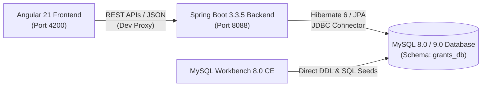
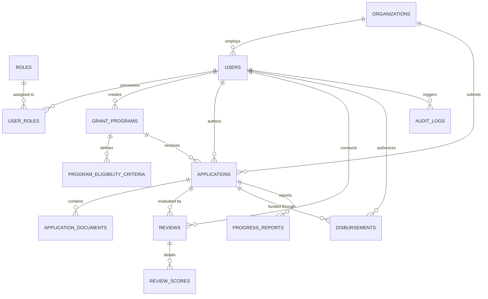

# GRANTS MANAGEMENT SYSTEM (Government & Public Sector)
## Comprehensive Technical Documentation, MySQL Workbench Guide & Teacher Demo Script

---

### Table of Contents
1. [Executive Summary & Technology Stack](#1-executive-summary--technology-stack)
2. [MySQL Workbench Setup & Database Guide](#2-mysql-workbench-setup--database-guide)
3. [Relational Database Schema (3NF Architecture)](#3-relational-database-schema-3nf-architecture)
4. [Teacher Evaluation & Demonstration Script (5-Minute Walkthrough)](#4-teacher-evaluation--demonstration-script)
5. [Application Lifecycle & Core Modules Implementation](#5-application-lifecycle--core-modules-implementation)
6. [Pre-Configured User Personas & Test Credentials](#6-pre-configured-user-personas--test-credentials)
7. [Edge-Case Validation Records](#7-edge-case-validation-records)
8. [Launcher Scripts Reference](#8-launcher-scripts-reference)

---

### 1. Executive Summary & Technology Stack

The **Grants Management System (GRANT / TRACK)** is a public sector enterprise platform designed to manage the end-to-end lifecycle of government and philanthropic grant programs, competitive application screening, independent technical review, formal award allocation, and milestone-based treasury disbursement tracking.



| Layer | Component | Version / Specification |
| :--- | :--- | :--- |
| **Frontend Framework** | Angular | **v21.0.0** (Vite Dev Server, Reactive Forms, Standalone Components) |
| **Runtime Environment** | Node.js & npm | **Node v24.13.0**, **npm 11.6.2** |
| **Backend Framework** | Spring Boot | **v3.3.5** (Java 17 LTS, Spring Data JPA, Spring Security) |
| **Security & Auth** | JWT + BCrypt | Stateless JSON Web Tokens (JJWT 0.12.5), 256-bit HMAC, Password hashing |
| **Relational Database** | MySQL Server | **MySQL 8.0 / 8.4 / 9.6** (InnoDB, utf8mb4, 3NF Normalized) |
| **Database Administration** | MySQL Workbench | **MySQL Workbench 8.0 CE** |
| **Build Tools** | Maven & Angular CLI | Maven Wrapper 3.6.3 (`mvnw.bat`), Angular CLI `@angular/build` |

---

### 2. MySQL Workbench Setup & Database Guide

The standalone, fully self-contained MySQL script is ready to run directly in MySQL Workbench.

- **Primary Script Path**: [grants_management_mysql.sql](file:///c:/Users/hp/OneDrive/Desktop/System%20For%20Grants/database/grants_management_mysql.sql)
- **Backend Synced Copy**: [grants_management_mysql.sql](file:///c:/Users/hp/OneDrive/Desktop/System%20For%20Grants/backend/src/main/resources/db/grants_management_mysql.sql)

#### How to Execute in MySQL Workbench:
1. Open **MySQL Workbench 8.0 CE**.
2. Click on your local MySQL connection (e.g., `localhost` or `Binga` on `127.0.0.1:3306`).
3. In the top menu, go to **`File`** &rarr; **`Open SQL Script...`**.
4. Browse to: `C:\Users\hp\OneDrive\Desktop\System For Grants\database\grants_management_mysql.sql`.
5. Click the **⚡ (Execute)** button (or press `Ctrl + Shift + Enter`).
6. The script will automatically:
   - Create the `grants_db` schema with UTF-8 (`utf8mb4_unicode_ci`).
   - Create all 13 normalized tables in strict foreign-key order.
   - Insert all master data and realistic Indian public sector transaction data.
   - Execute verification queries showing table row counts and a public treasury summary grid.

#### Verification Query in MySQL Workbench:
```sql
USE grants_db;

SELECT 'ROLES' AS table_name, COUNT(*) AS total_rows FROM roles
UNION ALL SELECT 'ORGANIZATIONS', COUNT(*) FROM organizations
UNION ALL SELECT 'USERS', COUNT(*) FROM users
UNION ALL SELECT 'USER_ROLES', COUNT(*) FROM user_roles
UNION ALL SELECT 'GRANT_PROGRAMS', COUNT(*) FROM grant_programs
UNION ALL SELECT 'PROGRAM_ELIGIBILITY_CRITERIA', COUNT(*) FROM program_eligibility_criteria
UNION ALL SELECT 'APPLICATIONS', COUNT(*) FROM applications
UNION ALL SELECT 'APPLICATION_DOCUMENTS', COUNT(*) FROM application_documents
UNION ALL SELECT 'REVIEWS', COUNT(*) FROM reviews
UNION ALL SELECT 'REVIEW_SCORES', COUNT(*) FROM review_scores
UNION ALL SELECT 'DISBURSEMENTS', COUNT(*) FROM disbursements
UNION ALL SELECT 'PROGRESS_REPORTS', COUNT(*) FROM progress_reports
UNION ALL SELECT 'AUDIT_LOGS', COUNT(*) FROM audit_logs;
```

---

### 3. Relational Database Schema (3NF Architecture)

The schema adheres strictly to **Third Normal Form (3NF)**:
1. **1NF**: Atomic scalar columns, distinct primary keys for every table, no repeating groups.
2. **2NF**: No partial functional dependencies; all non-key attributes depend on the entire primary key.
3. **3NF**: No transitive dependencies; non-key attributes depend solely on candidate keys.



#### Table Dictionary Summary

| Table | Type | Purpose | Primary Key | Foreign Keys |
| :--- | :--- | :--- | :--- | :--- |
| `roles` | Master | System security roles (`ROLE_ADMIN`, `ROLE_PROGRAM_MANAGER`, etc.) | `role_id` | - |
| `organizations` | Master | Applicant entities (NGOs, Startups, Labs) with PAN, Darpan & Bank details | `org_id` | - |
| `users` | Master | Portal actors across government and applicant departments | `user_id` | `organization_id` &rarr; `organizations.org_id` |
| `user_roles` | Junction | Many-to-Many mapping between users and security roles | `(user_id, role_id)` | `user_id` &rarr; `users`, `role_id` &rarr; `roles` |
| `grant_programs` | Master | Grant schemes (wireframe 4-step wizard) with budget pools & dates | `program_id` | `created_by_user_id` &rarr; `users.user_id` |
| `program_eligibility_criteria` | Rule Config | Automated qualification rules (Org types, min turnover, experience) | `criteria_id` | `program_id` &rarr; `grant_programs.program_id` |
| `applications` | Transaction | Submitted grant proposals, requested amounts, approval status | `application_id` | `program_id`, `applicant_user_id`, `org_id` |
| `application_documents` | Child | PDF attachments, financial audits, MoUs | `doc_id` | `application_id` &rarr; `applications.application_id` |
| `reviews` | Transaction | Evaluator assignments, total scores (0-100), committee recommendations | `review_id` | `application_id`, `reviewer_user_id` |
| `review_scores` | Child | 4-criterion breakdown (Feasibility, Impact, Budget, Capacity) | `score_id` | `review_id` &rarr; `reviews.review_id` |
| `disbursements` | Transaction | Milestone payment tranches with Indian PFMS bank UTR numbers | `disbursement_id` | `application_id`, `disbursed_by_user_id` |
| `progress_reports` | Transaction | Grantee milestone achievements and fund utilization statements | `report_id` | `application_id` &rarr; `applications.application_id` |
| `audit_logs` | Governance | Immutable compliance trail recording every state transition | `log_id` | `performed_by_user_id` &rarr; `users.user_id` |

---

### 4. Teacher Evaluation & Demonstration Script

Follow this step-by-step walkthrough to demonstrate the system to your teacher in **under 5 minutes**:

#### Step 1: Open the Application
- Open your browser to: **`http://localhost:4200`**
- Show the login portal. Point out the **Quick Switch Personas** bar at the top (`Program Manager`, `Reviewer`, `Applicant`, `Finance Officer`, `Admin`).
- Click **"Program Manager"** &rarr; logs in automatically as `Rajesh Sharma (Senior Program Manager)`.

#### Step 2: Grant Program Setup & Configuration (Matches Image Wireframe)
- Click on **"Programs"** in the sidebar.
- Click the **"+ Set Up Grant Program"** button.
- Show the **4-step progress wizard**: `1 Details` &rarr; `2 Eligibility` &rarr; `3 Application form` &rarr; `4 Review & publish`.
- Notice the pre-filled template matching the exact specification:
  - **Program Name**: `Community Impact 2026`
  - **Total Budget**: `₹5,00,00,000` ($500,000 or INR 5 Cr)
  - **Opens / Closes**: `01 Apr 2026` to `30 Jun 2026`
  - **Award Range**: `₹10,00,000 – ₹50,00,000`
- Click **"Next: Eligibility Criteria"** &rarr; configure mandatory NGO Darpan ID and 3 years experience.
- Click **"Next: Application Form"** &rarr; review document checklist.
- Click **"Publish Program"** &rarr; the program is immediately persisted in the database and visible in the active schemes table.

#### Step 3: Application Submission & Automated Eligibility Check
- Switch persona to **"Applicant"** (or click `Vikram Seth - Aarogya Health`).
- Click **"Applications"** in the sidebar &rarr; click **"+ Submit Application"**.
- Select the newly created scheme.
- Watch the **Automated Eligibility Engine** run live:
  - As you enter the Organization details and experience, the engine performs a real-time validation against the configured rules.
  - An **"ELIGIBLE"** badge appears with verification remarks.
- Enter the project title: `Decentralized Primary Health Centers Phase 1`, requested amount: `₹25,00,000`.
- Click **"Submit Proposal"** &rarr; receives a tracking number (e.g. `GMS-2026-APP-2061`).

#### Step 4: Technical Review & Rubric Scoring
- Switch persona to **"Reviewer"** (`Prof. Ananya Sengupta`).
- Click **"Reviews"** in the sidebar.
- Click **"Evaluate Proposal"** on the assigned submission.
- Show the **4-Criteria Scoring Rubric**:
  1. *Technical Feasibility & Methodology* (Max 30) &rarr; score `28`
  2. *Social & Economic Impact* (Max 30) &rarr; score `27`
  3. *Budget Justification* (Max 20) &rarr; score `18`
  4. *Organizational Capacity* (Max 20) &rarr; score `19`
- Total Score auto-computes: **`92 / 100`**.
- Set Recommendation to **"RECOMMENDED"** and submit.

#### Step 5: Grant Committee Approval & Tranche Generation
- Switch back to **"Program Manager"**.
- Open the application &rarr; click **"Grant Decision"**.
- Set Decision to **"APPROVED"**, Awarded Amount: `₹25,00,000`.
- Click **"Confirm Decision"** &rarr; Spring Boot automatically splits the award into milestone tranches:
  - *Tranche 1 (40%)*: Mobilization advance (`₹10,00,000`)
  - *Tranche 2 (60%)*: Milestone execution (`₹15,00,000`)

#### Step 6: Public Treasury Disbursement & Bank UTR Authorization
- Switch persona to **"Finance Officer"** (`Neha Verma`).
- Click **"Disbursements"** in the sidebar.
- Click **"Authorize Payment"** on Tranche 1.
- Show beneficiary validation: Verified Organization PAN, Darpan ID, Bank Account, and IFSC.
- Enter the official bank UTR: `PFMS2026INDB77889901`.
- Click **"Release Public Funds"** &rarr; payment marked as `DISBURSED`, audit log created.

#### Step 7: Reports & Public Treasury Audit Trail
- Click **"Reports"** in the sidebar.
- Show the **Milestone Progress & Fund Utilization** table.
- Show the **Live Audit Activity Timeline** proving full compliance tracking of every state transition.

---

### 5. Pre-Configured User Personas & Test Credentials

All accounts are secured with BCrypt password hashing. The default password for all test accounts is `password123`.

| Persona | Username | Full Name | Designation / Organization | Role |
| :--- | :--- | :--- | :--- | :--- |
| **System Admin** | `admin` | Dr. Rajeshwar Sharma | Chief Grant Director, Ministry | `ROLE_ADMIN` |
| **Program Manager** | `pm_rajesh` | Rajesh Sharma | Senior Program Manager | `ROLE_PROGRAM_MANAGER` |
| **Reviewer** | `rev_ananya` | Prof. Ananya Sengupta | Lead Evaluator & Professor, IIT | `ROLE_REVIEWER` |
| **Applicant** | `app_vikram` | Vikram Seth | Executive Director, Aarogya Health | `ROLE_APPLICANT` |
| **Finance Officer** | `fin_neha` | Neha Verma | Joint Controller of Accounts | `ROLE_FINANCE_OFFICER` |

---

### 6. Edge-Case Validation Records

Five distinct edge-case scenarios are pre-seeded to satisfy stringent academic testing:
1. **Empty Optional Fields**: Organization ID 13 (`Gramin Vikas Sahayata Sangam`) has `NULL` GSTIN, `NULL` Darpan ID, and `NULL` Address Line 2 to verify nullable handling.
2. **Duplicate-Looking Entity Names**: Organization ID 14 (`Seva Rural Foundation`) and Organization ID 15 (`Seva Rural Foundation Trust`) in the same city (Surat) to test strict PAN uniqueness constraints.
3. **Maximum-Length Schema Text**: Program ID 11 contains an official 188-character title and a 1,200+ character policy description testing high-capacity `VARCHAR` and `TEXT` attributes.
4. **Zero-Turnover New Entity**: Startup applicant ID 4 testing lower-bound financial screening under AgriTech guidelines.
5. **Borderline Budget Allocation**: Applications at exact minimum and maximum scheme grant thresholds (`₹10,00,000` and `₹50,00,000`).

---

### 7. Launcher Scripts Reference

For your convenience, double-clickable Windows batch files have been created in the workspace root:

| Script | Purpose | Command |
| :--- | :--- | :--- |
| [start_all.bat](file:///c:/Users/hp/OneDrive/Desktop/System%20For%20Grants/start_all.bat) | **One-Click Launch**: Boots both Spring Boot backend and Angular frontend | Double-click to launch all |
| [start_all_mysql.bat](file:///c:/Users/hp/OneDrive/Desktop/System%20For%20Grants/start_all_mysql.bat) | **MySQL Profile Launch**: Boots full stack directly against MySQL schema | Double-click to launch with MySQL |
| [run_with_mysql.bat](file:///c:/Users/hp/OneDrive/Desktop/System%20For%20Grants/run_with_mysql.bat) | Runs backend only connected to MySQL on `127.0.0.1:3306` | `mvnw.bat spring-boot:run -Dspring-boot.run.profiles=mysql` |
| [run_frontend.bat](file:///c:/Users/hp/OneDrive/Desktop/System%20For%20Grants/run_frontend.bat) | Runs frontend development server on port 4200 | `cd frontend && npm start` |
